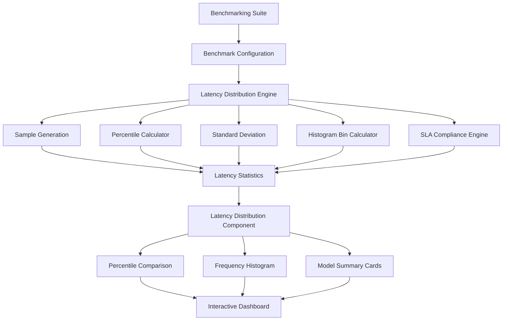

# SpeechScale-AI-Speech-Recognition-ML-Infrastructure-Platform
SpeechScale AI — Speech Recognition &amp; ML Infrastructure Platform
# SpeechScale — Latency Percentile Distribution & Outlier Histogram

### Enterprise-Grade Whisper Benchmarking, Tail Latency Analysis & GPU Performance Diagnostics

<p align="center">

**Measure Beyond Average Latency. Understand Every Millisecond.**

An interactive, dual-mode performance visualization system for analyzing latency distributions, identifying extreme outliers, monitoring SLA compliance, and comparing Whisper model architectures under different inference workloads.

</p>

---

## Table of Contents

1. [Overview](#1-overview)
2. [Problem Statement](#2-problem-statement)
3. [Core Objectives](#3-core-objectives)
4. [Key Features](#4-key-features)
5. [Supported Whisper Models](#5-supported-whisper-models)
6. [System Architecture](#6-system-architecture)
7. [Visualization Modes](#7-visualization-modes)
8. [Statistical Metrics & Mathematical Formulations](#8-statistical-metrics--mathematical-formulations)
9. [Latency Histogram Algorithm](#9-latency-histogram-algorithm)
10. [Cross-Model Comparison Matrix](#10-cross-model-comparison-matrix)
11. [Live Benchmark Synchronization](#11-live-benchmark-synchronization)
12. [Performance Simulation Engine](#12-performance-simulation-engine)
13. [Technical Stack](#13-technical-stack)
14. [Project Directory Structure](#14-project-directory-structure)
15. [Installation & Setup](#15-installation--setup)
16. [Implementation Guide](#16-implementation-guide)
17. [Component Integration](#17-component-integration)
18. [Testing & Validation](#18-testing--validation)
19. [Performance & Optimization](#19-performance--optimization)
20. [Accessibility](#20-accessibility)
21. [Limitations & Benchmark Integrity](#21-limitations--benchmark-integrity)
22. [Future Roadmap](#22-future-roadmap)
23. [Contributing](#23-contributing)
24. [License](#24-license)

---

# 1. Overview

**SpeechScale Latency Percentile Distribution & Outlier Histogram** is an enterprise-grade performance analysis component integrated into the SpeechScale Benchmarking Suite.

It provides ML infrastructure engineers, AI researchers, GPU optimization specialists, and inference platform developers with a detailed view of speech recognition latency across different Whisper model architectures and serving configurations.

Unlike traditional benchmarking dashboards that focus primarily on average inference time, this component analyzes the complete latency distribution, including median performance, tail latency, extreme outliers, and SLA compliance.

The visualization supports two complementary analytical modes:

- **Cross-Model Percentile Comparison:** Compare p50, p95, and p99 latency across six Whisper model configurations.
- **Latency Frequency Distribution:** Inspect individual request latency distributions through ten equal-width histogram buckets.

The component also synchronizes with upstream benchmarking controls, allowing users to explore how concurrency, inference engines, quantization, and SLA thresholds affect system performance.

### Primary Capabilities

| Capability | Description |
|---|---|
| Percentile Analysis | p50, p95, p99 latency |
| Outlier Detection | Identify extreme latency spikes |
| Histogram Distribution | Ten equal-width latency buckets |
| SLA Monitoring | Pass rate and breach classification |
| Model Comparison | Six Whisper architectures |
| Concurrency Simulation | 5, 20, 50, 100 streams |
| Engine Comparison | CTranslate2, TensorRT-LLM, PyTorch |
| Quantization Analysis | INT4, INT8, FP16, FP32 |
| Live Synchronization | Reactively updates with benchmark inputs |
| Statistical Analysis | Standard deviation, tail spread, inflation ratio |

---

# 2. Problem Statement

Average latency is not a sufficient measurement for evaluating production-grade speech recognition infrastructure.

Consider two hypothetical inference systems:

**System A**

- Average latency: 250 ms
- p50: 220 ms
- p95: 350 ms
- p99: 450 ms

**System B**

- Average latency: 250 ms
- p50: 180 ms
- p95: 900 ms
- p99: 1,800 ms

Both systems have the same average latency, but their operational characteristics are significantly different.

System B experiences substantial tail latency, potentially resulting in:

- Delayed transcription responses.
- Increased request queueing.
- GPU scheduling contention.
- Memory allocation overhead.
- KV-cache paging in applicable inference architectures.
- Redis queue contention.
- Client-side request timeouts.
- Unpredictable service-level performance.

SpeechScale addresses this problem by making latency distribution visible rather than reducing performance evaluation to a single average value.

### Engineering Objective

Provide a unified diagnostic interface that helps engineers answer:

1. Which Whisper model delivers the lowest median latency?
2. Which model maintains the most stable p95 and p99 performance?
3. Which configurations experience extreme latency spikes?
4. How does concurrency influence request distribution?
5. Which serving engine performs best under equivalent conditions?
6. How much latency is introduced by quantization choices?
7. What percentage of requests satisfies the configured SLA?
8. Which model is most suitable for a production workload?

---

# 3. Core Objectives

The component is designed around five engineering objectives.

### 3.1 Distribution Visibility

Visualize the complete request latency distribution rather than relying exclusively on average inference time.

### 3.2 Tail Latency Diagnostics

Identify performance degradation in the slowest 5% and 1% of requests.

### 3.3 SLA Compliance Monitoring

Measure the proportion of successful requests that complete within the configured latency threshold.

### 3.4 Cross-Architecture Benchmarking

Compare Whisper model variants under consistent benchmark conditions.

### 3.5 Interactive Workload Analysis

Allow engineers to modify concurrency, serving engine, quantization, and SLA targets without manually recalculating the visualization.

---

# 4. Key Features

## 4.1 Dual-Mode Interactive Visualization

Switch between macro-level percentile comparison and micro-level frequency distribution.

## 4.2 Percentile Metrics

- p50 Median Latency
- p95 Tail Latency
- p99 Extreme Tail Latency

## 4.3 Ten-Bucket Histogram

Partitions benchmark request samples into ten equal-width latency intervals.

## 4.4 SLA Threshold Reference

Displays an amber dashed horizontal reference line on the percentile comparison chart.

## 4.5 Interactive Forensic Tooltips

Provides exact latency measurements, tail spread, and SLA status.

## 4.6 Model Summary Cards

Displays six responsive model cards with percentile metrics and compliance status.

## 4.7 Live Configuration Synchronization

Automatically updates the chart when upstream benchmark controls change.

## 4.8 Statistical Analysis

Calculates:

- Mean latency.
- Median latency.
- Standard deviation.
- p95 and p99.
- Tail spread.
- Tail inflation ratio.
- SLA pass rate.
- Histogram frequencies.

---

# 5. Supported Whisper Models

The benchmarking component supports six model configurations.

| Model | Parameters | Architecture Category |
|---|---:|---|
| Whisper Tiny | 39M | Compact |
| Whisper Base | 74M | Lightweight |
| Whisper Small | 244M | Small |
| Distil-Whisper-v3 | 756M | Distilled |
| Whisper Medium | 769M | Medium |
| Whisper Large-v3 | 1,550M | Large |

**Important:** Parameter counts are model-family metadata. Actual parameter counts and supported checkpoints should be verified against the exact model artifacts used by the benchmark.

### Model Metadata

Each model configuration should contain:

- Unique model identifier.
- Display name.
- Parameter count.
- Architecture type.
- Model checkpoint.
- Supported precision formats.
- Serving engine compatibility.
- GPU memory requirements.
- Benchmark request samples.
- Statistical summary.

---

# 6. System Architecture

The component follows a modular architecture that separates statistical calculations, visualization, and benchmark integration.

### Architecture Overview



### Architectural Layers

**Layer 1 — Benchmark Configuration**

Receives upstream configuration:

- Model selection.
- Concurrency level.
- Serving engine.
- Quantization.
- SLA target.

**Layer 2 — Statistical Engine**

Processes raw or simulated request latency samples.

**Layer 3 — Distribution Processor**

Calculates percentiles, statistical measurements, and histogram buckets.

**Layer 4 — Visualization Layer**

Displays results through Recharts and React components.

**Layer 5 — Benchmark Integration**

Synchronizes the visualization with the primary Benchmarking Suite.

---

# 7. Visualization Modes

## Mode A — Cross-Model Percentile Comparison

This mode compares p50, p95, and p99 across all six supported Whisper models.

### Chart Type

Grouped bar chart.

### X-Axis

Whisper model names.

### Y-Axis

Latency measured in milliseconds (ms).

### Percentile Color System

| Metric | Color | Hex |
|---|---|---|
| p50 Median | Cyan | #06b6d4 |
| p95 Tail | Indigo | #6366f1 |
| p99 Extreme | Rose | #f43f5e |
| SLA Threshold | Amber | #f59e0b |

### Chart Configuration

The chart should include:

- Three grouped bars per model.
- Responsive chart dimensions.
- Millisecond-based Y-axis.
- Interactive tooltips.
- SLA reference line.
- Model labels.
- Percentile legend.
- Horizontal grid lines.

### SLA Reference Line

The SLA threshold is represented using an amber dashed line.

Supported example thresholds:

- 500 ms.
- 800 ms.
- 1,200 ms.
- 2,000 ms.

### Interactive Tooltip

When hovering over a model's percentile bars, display:

```text
WHISPER LARGE-V3

p50 Median:       420 ms
p95 Tail:         760 ms
p99 Extreme:    1,050 ms

Tail Spread:      630 ms

SLA Target:       800 ms
SLA Status:       BREACH
```

The compliance badge should be calculated from the configured SLA metric.

For example, if the SLA is defined using p95:

- p95 <= SLA: PASSED.
- p95 > SLA: BREACH.

The p99 value should remain visible even when p95 passes the SLA.

---

## Mode B — Latency Frequency Histogram

This mode provides a detailed view of individual request latency distribution for the currently selected model.

### Histogram Design

The distribution processor divides the minimum-to-maximum sample range into ten equal-width intervals.

Example:

| Bucket | Latency Range |
|---|---|
| 01 | 100–190 ms |
| 02 | 190–280 ms |
| 03 | 280–370 ms |
| 04 | 370–460 ms |
| 05 | 460–550 ms |
| 06 | 550–640 ms |
| 07 | 640–730 ms |
| 08 | 730–820 ms |
| 09 | 820–910 ms |
| 10 | 910–1,000 ms |

These values are illustrative. Actual boundaries must be calculated from the active benchmark samples.

### Histogram Color System

| Latency Regime | Color | Hex |
|---|---|---|
| Median Region | Cyan | #06b6d4 |
| Normal Distribution | Indigo | #6366f1 |
| Upper Tail | Purple | #a855f7 |
| SLA Violation | Rose | #f43f5e |

Color classification should be based on bucket position relative to the calculated percentile and SLA boundaries.

### Histogram Tooltip

Each bucket tooltip displays:

- Minimum latency.
- Maximum latency.
- Request count.
- Percentage of total requests.
- Latency classification.

Example:

```text
LATENCY BUCKET 06

Range:       550–640 ms
Requests:    145
Density:     14.5%

Classification: NORMAL SPREAD
```

### Distribution Header

The histogram header should display:

- Selected model.
- Parameter count.
- Serving engine.
- Quantization.
- Standard deviation.
- SLA pass rate.
- Total benchmark requests.

---

# 8. Statistical Metrics & Mathematical Formulations

All metrics are calculated using the benchmark's latency sample collection.

Let:

\[
X = \{x_1,x_2,\ldots,x_n\}
\]

where each \(x_i\) represents an individual request latency in milliseconds.

Sort the samples:

\[
x_{(1)} \leq x_{(2)} \leq \ldots \leq x_{(n)}
\]

## 8.1 Mean Latency

\[
\mu = \frac{1}{n}\sum_{i=1}^{n}x_i
\]

Represents average request latency.

## 8.2 p50 — Median Latency

The 50th percentile represents the latency below which approximately 50% of requests complete.

## 8.3 p95 — Tail Latency

The 95th percentile represents the latency below which approximately 95% of requests complete.

This is particularly important for production service-level objectives.

## 8.4 p99 — Extreme Tail Latency

The 99th percentile represents the latency below which approximately 99% of requests complete.

It helps identify extreme performance degradation.

### Percentile Interpolation

Use a documented and consistent percentile convention.

For example, with linear interpolation:

\[
h=(n-1)p
\]

\[
P(p)=x_{(\lfloor h\rfloor+1)}
+d\left(x_{(\lfloor h\rfloor+2)}-x_{(\lfloor h\rfloor+1)}\right)
\]

where:

- \(p\) is the percentile expressed between 0 and 1.
- \(d=h-\lfloor h\rfloor\).
- Samples use zero-based indexing in implementation.

This convention should be used consistently across the benchmarking suite.

## 8.5 Tail Spread

Measures the absolute difference between extreme tail latency and median latency.

\[
TailSpread=p99-p50
\]

A smaller tail spread generally indicates more predictable request latency.

## 8.6 Tail Inflation Ratio

Measures how much larger p99 latency is compared with p50.

\[
TailInflationRatio=\frac{p99}{p50}
\]

A value close to 1 indicates a relatively narrow percentile spread.

The ratio should be handled safely when p50 is zero or unavailable.

## 8.7 Standard Deviation

Population standard deviation:

\[
\sigma=\sqrt{\frac{1}{n}\sum_{i=1}^{n}(x_i-\mu)^2}
\]

For sample-based estimates, use sample standard deviation instead:

\[
s=\sqrt{\frac{1}{n-1}\sum_{i=1}^{n}(x_i-\bar{x})^2}
\]

The dashboard must clearly identify which definition is being used.

## 8.8 SLA Pass Rate

Let \(T\) represent the configured SLA threshold.

\[
SLA\ PassRate=
\frac{\#\{x_i:x_i\leq T\}}{n}\times100
\]

Example:

- Total requests: 1,000.
- Requests within SLA: 860.
- Requests exceeding SLA: 140.

\[
SLA\ PassRate=86\%
\]

## 8.9 SLA Breach Rate

\[
SLA\ BreachRate=100-SLA\ PassRate
\]

## 8.10 Histogram Density

For bucket \(i\):

\[
Density_i=\frac{Count_i}{n}\times100
\]

The sum of all bucket counts must equal the total number of valid latency samples.

---

# 9. Latency Histogram Algorithm

The statistical utility is implemented independently of React.

### File

`src/utils/latencyDistribution.ts`

### Equal-Width Bucket Partitioning

For \(k=10\) buckets:

\[
Width=\frac{MaxLatency-MinLatency}{k}
\]

Bucket boundaries are calculated from the minimum and maximum observed latency.

For each request sample, determine its appropriate bucket.

### Algorithm Requirements

1. Validate incoming samples.
2. Exclude invalid, negative, and non-finite values.
3. Sort samples where required.
4. Calculate minimum and maximum latency.
5. Calculate ten equal-width intervals.
6. Count samples in each interval.
7. Calculate request percentages.
8. Classify latency regions.
9. Handle identical sample values.
10. Ensure the maximum value is included in the final bucket.

### Pseudocode

```typescript
function computeHistogramBins(
  samples: number[],
  bucketCount = 10
) {
  if (samples.length === 0) {
    return [];
  }

  const min = Math.min(...samples);
  const max = Math.max(...samples);

  if (min === max) {
    return [{
      min,
      max,
      count: samples.length,
      percentage: 100
    }];
  }

  const width = (max - min) / bucketCount;

  const bins = Array.from(
    { length: bucketCount },
    (_, index) => ({
      min: min + index * width,
      max: min + (index + 1) * width,
      count: 0,
      percentage: 0
    })
  );

  for (const sample of samples) {
    const index = Math.min(
      Math.floor((sample - min) / width),
      bucketCount - 1
    );

    bins[index].count++;
  }

  for (const bin of bins) {
    bin.percentage =
      (bin.count / samples.length) * 100;
  }

  return bins;
}
```

Production implementation should additionally validate bucket count and filter invalid samples before calculation.

---

# 10. Cross-Model Comparison Matrix

Directly beneath the chart viewport, a responsive six-card model comparison grid displays all supported models.

### Model Card Information

Each card includes:

- Model name.
- Parameter count.
- p50 latency.
- p95 latency.
- p99 latency.
- Tail spread.
- Tail inflation ratio.
- SLA status.

### Status Indicators

**OK — Emerald**

The selected SLA percentile meets the configured threshold.

**BREACH — Rose**

The selected SLA percentile exceeds the configured threshold.

### Model Selection Interaction

When a user clicks a model card:

1. Update the selected model.
2. Highlight the active card.
3. Update the frequency histogram.
4. Update model metadata.
5. Recalculate displayed statistical summaries.
6. Synchronize the selection with the primary Benchmarking Suite control panel.

The selected model should be maintained in shared parent state rather than duplicated across unrelated components.

---

# 11. Live Benchmark Synchronization

The component receives updated configuration through React props or shared benchmark state.

### 11.1 Concurrency Level

Supported configurations:

| Concurrency | Description |
|---|---|
| 5 | Low concurrent workload |
| 20 | Moderate workload |
| 50 | High workload |
| 100 | Heavy concurrent workload |

Higher concurrency may increase:

- Queue waiting time.
- GPU scheduling contention.
- Memory pressure.
- Request processing delays.
- Tail latency.

### 11.2 Serving Engine

Supported engines:

**Faster-Whisper (CTranslate2)**

Optimized Whisper inference using CTranslate2.

**TensorRT-LLM**

GPU inference optimization through NVIDIA TensorRT-LLM, subject to actual Whisper model and runtime integration support.

**PyTorch Eager**

Reference inference execution using PyTorch eager mode.

### 11.3 Quantization

| Precision | Description |
|---|---|
| INT4 | Four-bit quantization |
| INT8 | Eight-bit quantization |
| FP16 | Half-precision floating point |
| FP32 | Single-precision floating point |

Quantization affects model memory consumption, numerical behavior, and execution performance.

### 11.4 SLA Target

Supported example thresholds:

- 500 ms.
- 800 ms.
- 1,200 ms.
- 2,000 ms.

Changing the SLA threshold must automatically update:

- SLA reference line.
- SLA pass rate.
- Breach rate.
- Model compliance classifications.
- Histogram SLA violation regions.

---

# 12. Performance Simulation Engine

The benchmark interface may provide simulated distributions when actual GPU execution is unavailable.

Simulation must be clearly labeled as simulated data and must never be presented as real hardware benchmark measurements.

### Simulation Inputs

```typescript
interface BenchmarkConfig {
  modelId: string;
  concurrency: number;
  engine: "ctranslate2" | "tensorrt" | "pytorch";
  quantization: "int4" | "int8" | "fp16" | "fp32";
  slaTargetMs: number;
}
```

### Simulation Pipeline

```text
Benchmark Configuration
        |
        v
Base Model Latency
        |
        v
Serving Engine Adjustment
        |
        v
Quantization Adjustment
        |
        v
Concurrency / Queueing Adjustment
        |
        v
Latency Sample Generation
        |
        v
Statistical Analysis
        |
        v
Histogram + Percentile Visualization
```

The simulator should use deterministic seeded randomness for repeatable comparisons.

It should also account for:

- Warm-up requests.
- Audio duration.
- Batch size.
- Input sequence length.
- GPU type.
- Memory capacity.
- Concurrent workload.
- Queue waiting time.
- Inference execution time.

A fixed percentage improvement, such as a claimed 58% CTranslate2 speedup, must not be treated as universal. Performance differences depend on the model, hardware, workload, batch configuration, and software versions.

---

# 13. Technical Stack

| Technology | Purpose |
|---|---|
| React | Component architecture |
| TypeScript | Type safety |
| Recharts | Data visualization |
| Tailwind CSS | Styling |
| Lucide React | Interface icons |
| Vite | Development and build tooling |
| Vitest | Unit testing |
| React Hooks | State management |
| Whisper | Speech recognition benchmarking |
| CTranslate2 | Optimized inference |
| PyTorch | Model execution |
| TensorRT-LLM | GPU inference optimization where supported |

---

# 14. Project Directory Structure

```text
src/
│
├── components/
│   ├── LatencyDistributionHistogram.tsx
│   ├── BenchmarkingSuite.tsx
│   ├── ModelSummaryCard.tsx
│   ├── PercentileComparisonChart.tsx
│   ├── LatencyFrequencyHistogram.tsx
│   └── BenchmarkTooltip.tsx
│
├── utils/
│   ├── latencyDistribution.ts
│   ├── latencyDistribution.test.ts
│   ├── percentileCalculator.ts
│   ├── histogramCalculator.ts
│   └── benchmarkSimulator.ts
│
├── types/
│   └── latency.ts
│
├── hooks/
│   └── useLatencyDistribution.ts
│
├── constants/
│   └── whisperModels.ts
│
└── App.tsx
```

### Main Files

**latencyDistribution.ts**

Pure statistical calculations, percentile interpolation, sample processing, standard deviation, and histogram binning.

**latencyDistribution.test.ts**

Unit tests for statistical correctness and edge cases.

**LatencyDistributionHistogram.tsx**

Main interactive React component.

**BenchmarkingSuite.tsx**

Parent dashboard responsible for configuration management and synchronization.

**benchmarkSimulator.ts**

Optional deterministic sample generator for demonstration and simulated workloads.

---

# 15. Installation & Setup

### Prerequisites

- Node.js 20 or later.
- npm or pnpm.
- React-compatible Vite project.
- TypeScript.
- Recharts.
- Tailwind CSS.
- Lucide React.

### Step 1 — Install Dependencies

```bash
npm install recharts lucide-react
```

### Step 2 — Development Dependencies

```bash
npm install -D vitest @testing-library/react @testing-library/jest-dom jsdom
```

### Step 3 — Create Component Files

```bash
mkdir -p src/components
mkdir -p src/utils
mkdir -p src/types
mkdir -p src/hooks
mkdir -p src/constants
```

### Step 4 — Implement Statistical Utilities

Create:

```text
src/utils/latencyDistribution.ts
```

### Step 5 — Implement the Visualization

Create:

```text
src/components/LatencyDistributionHistogram.tsx
```

### Step 6 — Integrate with Benchmarking Suite

Import the component into:

```text
src/components/BenchmarkingSuite.tsx
```

### Step 7 — Start Development Server

```bash
npm run dev
```

### Step 8 — Run Tests

```bash
npx vitest run
```

---

# 16. Implementation Guide

### Main Component Interface

```typescript
interface LatencyDistributionProps {
  selectedModel: string;
  concurrency: number;

  engine:
    | "ctranslate2"
    | "tensorrt"
    | "pytorch";

  quantization:
    | "int4"
    | "int8"
    | "fp16"
    | "fp32";

  slaTargetMs: number;

  samples: number[];

  onModelChange?: (modelId: string) => void;
}
```

### Recommended Component State

```typescript
type VisualizationMode =
  | "percentile"
  | "histogram";
```

The main component should manage:

- Active visualization mode.
- Selected model.
- Active histogram data.
- Tooltip visibility.
- Benchmark configuration.
- Derived statistical metrics.

Derived values should be memoized where appropriate.

### Example Integration

```tsx
<LatencyDistributionHistogram
  selectedModel={selectedModel}
  concurrency={concurrency}
  engine={engine}
  quantization={quantization}
  slaTargetMs={slaTargetMs}
  samples={latencySamples}
  onModelChange={setSelectedModel}
/>
```

The parent Benchmarking Suite should own shared configuration state.

---

# 17. Component Integration

The Latency Distribution component is mounted directly within the SpeechScale Benchmarking Suite.

### Recommended Dashboard Order

```text
SPEECHSCALE BENCHMARKING SUITE

1. Model Configuration Panel

2. GPU Performance Metrics

3. GPU Saturation Heatmap

4. Latency Percentile Distribution
   & Outlier Histogram

5. Benchmark History Table

6. Performance Comparison Summary
```

### Integration Responsibilities

The parent component handles:

- Model selection.
- Concurrency selection.
- Engine configuration.
- Quantization selection.
- SLA target.
- Benchmark data.
- Shared state synchronization.

The latency visualization handles:

- Statistical calculations.
- Chart rendering.
- Histogram generation.
- Percentile comparison.
- SLA visualization.
- Model summary presentation.

This separation ensures maintainability and predictable component behavior.

---

# 18. Testing & Validation

Testing should cover mathematical correctness, distribution integrity, configuration changes, and visualization behavior.

### Unit Testing

File:

```text
src/utils/latencyDistribution.test.ts
```

### Test Categories

**1. Empty Input**

- Empty sample array.
- No invalid calculations.
- Empty histogram output.

**2. Single Value**

- Single latency sample.
- Correct percentile values.
- Correct standard deviation.
- Correct histogram representation.

**3. Percentile Ordering**

Verify:

\[
p50 \leq p95 \leq p99
\]

**4. Histogram Partitioning**

- Exactly ten buckets for non-degenerate input.
- Correct interval boundaries.
- No missing valid samples.
- Total bucket count equals valid sample count.
- Correct percentages.

**5. SLA Detection**

- All requests within SLA.
- All requests above SLA.
- Mixed compliance.
- Exact threshold boundary.

**6. Statistical Calculations**

- Mean.
- Median.
- Standard deviation.
- Tail spread.
- Tail inflation ratio.
- Pass rate.

**7. Invalid Inputs**

- NaN.
- Infinity.
- Negative latency.
- Invalid bucket count.
- Zero-valued latency.

**8. Synchronization**

- Model selection changes.
- Concurrency changes.
- Serving engine changes.
- Quantization changes.
- SLA changes.

### Validation Invariants

The implementation must maintain:

\[
p50 \leq p95 \leq p99
\]

\[
\sum_{i=1}^{k}Count_i=n
\]

\[
SLA\ PassRate+SLA\ BreachRate=100\%
\]

The histogram percentages should sum to approximately 100%, allowing floating-point rounding.

**Testing status:** Report the actual test count and result from the latest CI execution. Do not claim that all 40 tests pass unless that result has been verified.

---

# 19. Performance & Optimization

The component should remain responsive with large benchmark datasets.

### Optimization Strategies

1. Use `useMemo` for expensive statistical computations.
2. Avoid recalculating distributions on unrelated React renders.
3. Use efficient sorting algorithms.
4. Avoid unnecessary object creation during rendering.
5. Separate chart components from the main dashboard.
6. Use stable callback references.
7. Apply sample aggregation for very large datasets.
8. Avoid rendering individual requests as chart elements.
9. Use Web Workers for exceptionally large client-side datasets when justified.
10. Prefer server-side aggregation for distributed benchmark workloads.

### Suggested Performance Targets

These are engineering targets, not measured claims:

| Operation | Target |
|---|---|
| Histogram calculation | Under 20 ms for 10,000 samples |
| Percentile calculation | Under 20 ms for 10,000 samples |
| Chart interaction | Smooth responsive interaction |
| Model switching | Immediate UI update |
| SLA update | Immediate recalculation |
| Dashboard rendering | Responsive across desktop and mobile |

Actual performance should be measured on the target browser and hardware.

---

# 20. Accessibility

The component should support accessible data exploration.

Requirements:

- Keyboard-accessible mode toggle.
- Keyboard-accessible model selection.
- Visible focus indicators.
- Accessible chart titles.
- Text alternatives for visual metrics.
- Sufficient text and background contrast.
- Clear status labels.
- Screen-reader-friendly summaries.
- Do not communicate SLA status through colour alone.

---

# 21. Limitations & Benchmark Integrity

This component is a visualization and statistical analysis layer. It does not independently guarantee hardware-level benchmark accuracy.

### Important Considerations

**Simulated vs. Actual Data**

Simulated distributions are useful for demonstration and workload modelling. They must be explicitly distinguished from measurements collected from real inference execution.

**GPU Bottleneck Attribution**

A latency histogram can reveal unusual performance patterns, but it cannot independently prove that GPU kernel scheduling, memory allocation, or Redis contention caused an observed spike.

Additional profiling and tracing are required.

**KV-Cache Considerations**

Whisper inference and different serving implementations have different memory-management characteristics. KV-cache paging should only be attributed where the actual runtime architecture supports it and profiling confirms its involvement.

**SLA Definition**

The component should distinguish between:

- p95 latency objectives.
- p99 latency objectives.
- Per-request deadline compliance.
- End-to-end audio processing latency.
- Model inference-only latency.

**Comparable Benchmarks**

Cross-model comparisons should use consistent:

- Audio datasets.
- Audio durations.
- Batch sizes.
- Hardware.
- Warm-up procedures.
- Concurrency.
- Timing boundaries.
- Software versions.

Without consistent benchmark conditions, cross-model conclusions may be misleading.

---

# 22. Future Roadmap

### Phase 1 — Core Visualization

- [x] Dual-mode visualization design.
- [x] Six-model comparison architecture.
- [x] Ten-bucket histogram specification.
- [x] SLA threshold visualization.
- [x] Statistical metric definitions.
- [ ] Verify implementation against specification.
- [ ] Complete automated test coverage.

### Phase 2 — Advanced Diagnostics

- [ ] Live GPU utilization integration.
- [ ] VRAM consumption monitoring.
- [ ] GPU temperature monitoring.
- [ ] Queue waiting-time analysis.
- [ ] Request-level outlier identification.
- [ ] Audio-duration normalization.
- [ ] Batch-size comparison.

### Phase 3 — Production Observability

- [ ] Prometheus metrics integration.
- [ ] OpenTelemetry tracing.
- [ ] Grafana dashboard integration.
- [ ] Redis queue monitoring.
- [ ] Real-time benchmark streaming.
- [ ] Historical latency comparisons.
- [ ] Automated anomaly detection.

### Phase 4 — Enterprise Benchmark Intelligence

- [ ] Automated model recommendations.
- [ ] Hardware-aware inference optimization.
- [ ] Cost-per-minute transcription analysis.
- [ ] SLA forecasting.
- [ ] Multi-GPU benchmark comparison.
- [ ] Distributed inference benchmarking.
- [ ] Exportable enterprise performance reports.

---

# 23. Contributing

Contributions are welcome from developers, ML infrastructure engineers, performance researchers, and open-source contributors.

### Contribution Guidelines

1. Fork the repository.
2. Create a feature branch.
3. Follow the TypeScript coding conventions.
4. Keep statistical calculations independent of UI components.
5. Add unit tests for new algorithms.
6. Validate edge cases.
7. Run the test suite.
8. Submit a pull request with implementation details.

### Suggested Branch Naming

```text
feature/latency-histogram
feature/percentile-analysis
feature/gpu-profiling
feature/sla-monitoring
fix/histogram-bucket-boundary
```

---

# 24. License

Add the repository's actual license here.

If the project is distributed under the MIT License, include the appropriate MIT license file and copyright attribution.

---

## Final Summary

SpeechScale Latency Percentile Distribution & Outlier Histogram transforms raw inference timing measurements into actionable performance intelligence.

By combining percentile comparison, histogram distribution analysis, SLA compliance monitoring, and synchronized benchmark configuration, the component provides a unified environment for understanding speech recognition inference performance.

**Built for engineers who need to understand not only how fast their AI models run, but also how consistently they perform under real-world workloads.**

### SpeechScale

**Benchmark Intelligence. Latency Transparency. Production-Ready AI Performance.**
